 

**Systems, Automation & AI Tools Builder** — turning everyday friction into fast, zero-bloat software.

  

## `// ABOUT :: SYSTEM PROFILE`

I engineer focused, dependency-light software across **Python**, **C#/.NET**, **C++**, and **TypeScript** — from standalone Windows optimizers and codebase indexers to automated scanners and CLI/GUI utilities:

- **[Kenny PC Optimizer Studio](https://github.com/akashmark8-cloud/kenny-pc-optimizer-studio)** — Standalone zero-dependency Windows suite for system/browser scrubbing, safe empty-registry cleanup with mandatory backups, kernel RAM optimization & driver/app updates.
- **[CodeXRay](https://github.com/akashmark8-cloud/codexray)** — High-speed C++ codebase symbol indexer + MCP server giving AI coding agents instant architectural X-ray vision.
- **[SkipLink](https://github.com/akashmark8-cloud/skiplink)** — One-click bypass for ad-driven URL shorteners. Lands straight on the real link with zero ads.
- **[Stock Scanner](https://github.com/akashmark8-cloud/stock-scanner)** — Indian stock scanner powered by ML predictions for Groww watchlists.

  

## `// PUBLIC PROJECTS :: AUTO-SYNC MATRIX`

> *Auto-updated whenever a new public project is published via [GitHub Actions](.github/workflows/featured.yml).*

<!-- FEATURED:AUTO:START -->

   
   
   

<!-- FEATURED:AUTO:END -->

  

## `// TELEMETRY & LANGUAGE MATRIX`

## `// CONTRIBUTION GRID :: SNAKE`

<picture>
  <source media="(prefers-color-scheme: dark)" srcset="https://raw.githubusercontent.com/akashmark8-cloud/akashmark8-cloud/output/github-contribution-grid-snake-dark.svg" />
  
</picture>

  

## `// SUPPORT`

Free tools stay open and free — your support keeps the cyberdeck running:

---

*Built with Python, C#, C++, Arch Linux & Windows // `@akashmark8-cloud`*

